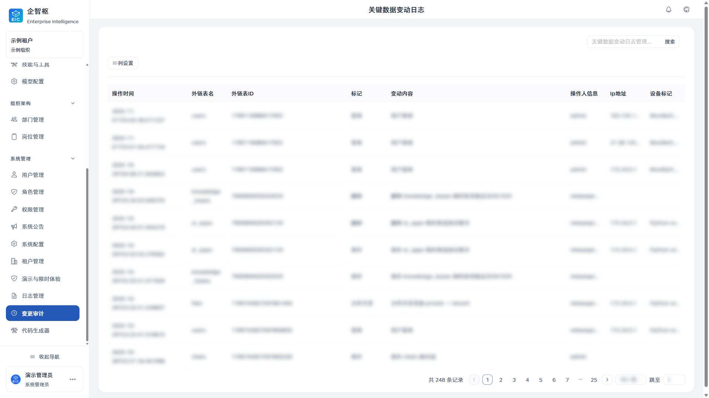
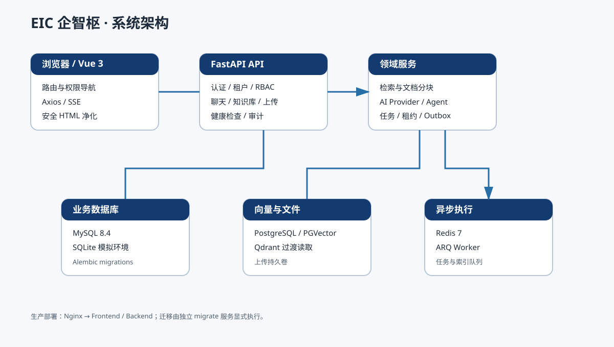

<div align="center">


# EIC | Enterprise Intelligence Center

[简体中文](README.md) | **English**

**A self-hostable AI workspace for enterprise knowledge work**

Bring knowledge retrieval, AI conversations, agent execution, access control, and run records into one workspace.


[Quick Start](#quick-start) · [Product Tour](#product-screens) · [Capabilities](#capabilities) · [Architecture](#architecture) · [Roadmap](#roadmap) · [Documentation](#documentation)


**Start with an assistant. Connect knowledge, tools, and your team.**

[Sign-in and Workspace](#screen-login) · [Explore Knowledge Bases](#screen-knowledge) · [Configure Agents](#screen-agents) · [Full Gallery (Chinese; English headings)](docs/screenshots/界面导览.md)

</div>

## What Is EIC

EIC brings knowledge bases and retrieval, model integrations, agent workflows, task execution, and administration into one platform for teams that need control over enterprise knowledge and access boundaries. It supports both a local simulation and self-hosted deployments.

**Documents and knowledge → retrieval and citations → agent conversations or tasks → run records and audit**

| For users | For builders | For admins |
| --- | --- | --- |
| Chat, choose assistants, find knowledge, and receive task messages. | Configure models, knowledge, tools, and context for different assistants. | Manage organizations, access, experience grants, and change records. |

<a id="capabilities"></a>

## Capabilities

| Capability | Description |
| --- | --- |
| Knowledge and retrieval | Parse, chunk, embed, and permission-filter documents; answers can include sources. |
| AI assistants | Multi-turn streaming conversations with configurable models, knowledge, skills, and tools. |
| Agents and tasks | Compose agent workflows with LangChain and LangGraph, with background task support. |
| Administration | Manage tenants, organizations, users, roles, and permissions. |
| Run records | Local run records and audit logs; optional Langfuse export is disabled by default. |

<a id="product-screens"></a>

## Product Tour

Explore EIC through eight scenarios, from sign-in to team administration. This page features **21 screenshots** with expandable configuration details. Both language versions use the same screenshots of the original Chinese interface. Visit the [full gallery (Chinese; English headings)](docs/screenshots/界面导览.md) for more screens.

| Get started | Build assistants | Manage your team |
| --- | --- | --- |
| [01 Sign In](#screen-login)<br>[02 Conversation Workspace](#screen-chat)<br>[03 Knowledge and Documents](#screen-knowledge) | [04 Agents and Memory](#screen-agents)<br>[05 Models, Prompts, and Tools](#screen-models)<br>[06 Tasks and Messages](#screen-tasks) | [07 Organization and Access](#screen-access)<br>[08 Audit and Experience Controls](#screen-audit) |

> **Source and scope:** The sign-in image was supplied by the maintainer. Other images show the authenticated cloud EIC UI with account, organization, configuration, and business data masked in the browser. Capture did not send chats, invoke models, or submit changes. Visible controls and states do not establish external-service validation. See the [capture notes (Chinese)](docs/screenshots/截图索引.md).

<a id="screen-login"></a>

### 01 · Sign In

The sign-in page brings tenant and account access together, with password and verification-code tabs plus demo, time-limited access, and registration entry points. Availability depends on deployment settings.


Start with the [local simulation](#quick-start), or read the [experience guide (Chinese)](docs/public-experience.md) before enabling public access.

<a id="screen-chat"></a>

### 02 · Conversation Workspace

Browse conversations on the left, work in the main chat area, and use the composer below. Choose an assistant to start a focused conversation. Content and dynamic settings are masked.


<details>
<summary>Show details: Choose an assistant</summary>

Browse assistants by purpose and keep conversations focused on their intended task. Visibility follows the current user's access.


</details>

<a id="screen-knowledge"></a>

### 03 · Knowledge and Documents

Organize documents by topic using knowledge-base cards, processing states, and management controls. Creation and detail views bring chunking settings, embedding and reranking models, and document states together.


<details>
<summary>Show details: Create a knowledge base and inspect documents</summary>

**Create:** Name a collection, select files or add text, and configure chunking and models. File saving, parsing, embedding, and indexing are distinct states.


**Inspect:** Review file types, processing states, chunk counts, and update times. A successful upload means the file was saved; processing results must be checked against backend records.


</details>

<a id="screen-agents"></a>

### 04 · Agents, Context, and Memory

The agent cards shown at the top organize assistants by purpose. The editor separates core settings, models and knowledge, tools, bindings, compression, long-term memory, and runtime limits into tabs.


<details>
<summary>Show details: Tools, long-term memory, and limits</summary>

**Tools:** Select tool, Skill, and MCP configurations for each assistant. Execution depends on integrations and permissions.


**Memory:** A dedicated tab configures memory mode. The UI states that it is off by default and extracted candidates require confirmation before use. See the [memory guide (Chinese)](docs/MEMORY-CONTEXT.md) for scope and write rules.


**Limits:** Configure session calls, tokens, duration, per-call timeouts, model steps, and threshold or failure policies. See [reliability and fallback (Chinese)](docs/RELIABILITY-FALLBACK.md) for runtime rules.


</details>

<a id="screen-models"></a>

### 05 · Models, Prompts, and Tools

Manage tenant defaults for embedding, reranking, and conversation titles and summaries alongside individual model cards. Knowledge bases can inherit defaults; model changes for existing indexes require explicit handling and rebuilding.


<details>
<summary>Show details: Model setup, prompts, and skills</summary>

**Model setup:** Use the model form to maintain connection settings and parameters. The screenshot shows the form, not usable credentials or a verified test call.


**Prompts:** Browse and maintain prompts for different purposes as inputs to assistant configuration.


**Skills and tools:** Browse configuration cards and deterministic, non-model tools in one directory. Visible entries include text statistics, JSON validation and formatting, and CSV numeric summaries; none were run during capture.


</details>

<a id="screen-tasks"></a>

### 06 · Tasks and Messages

The task page provides search, schedules and time zones, recent execution, and result entry points. **Automation is disabled and the queue is unavailable in this capture.** Running tasks requires deployment configuration and separate validation.


<details>
<summary>Show details: Message center</summary>

The message center separates system and private messages, company announcements, system notifications, and AI messages.


</details>

<a id="screen-access"></a>

### 07 · Organization and Access

Departments, positions, users, roles, and permissions form the administration workspace. Department hierarchy and lists describe team structure; role configuration separates API and menu permissions for access review.


<details>
<summary>Show details: Role permissions</summary>

Inspect a role's API and menu access with a tree selector. This shows the configuration structure; resource isolation and enforcement require validation in the intended deployment.


</details>

<a id="screen-audit"></a>

### 08 · Audit and Experience Controls

Filter change records by operation and object to inspect administrative activity. Operation logs and change audit have separate navigation entries; record fields are masked.



<details>
<summary>Show details: Demo and time-limited access</summary>

Administrators configure demo access, duration, concurrency and call allowances, and approved pages and resources for live access. Demos use synthetic data; live access is bounded by permissions and budgets. See the [experience guide (Chinese)](docs/public-experience.md).


</details>

[Browse All Screens (Chinese; English headings)](docs/screenshots/界面导览.md) · [Capture Coverage and Scope (Chinese)](docs/screenshots/截图索引.md) · [Run EIC Locally](#quick-start)

<a id="quick-start"></a>

## Quick Start

The local simulation requires Python 3.11+ and Node.js 20+. Use PowerShell 7 on Windows or Bash on Linux. Docker, MySQL, PostgreSQL, Redis, and a model API key are not required.

**Windows / PowerShell** (run from the repository root):

```powershell
python -m venv backend\.venv
backend\.venv\Scripts\python.exe -m pip install -e .\backend
Push-Location frontend
npm ci
npm run build
Pop-Location
pwsh -NoProfile -ExecutionPolicy Bypass -File .\scripts\start-sim.ps1 -OpenBrowser
```

**Linux / Bash** (run from the repository root):

```bash
python3 -m venv backend/.venv
backend/.venv/bin/python -m pip install -e ./backend
cd frontend
npm ci
npm run build
cd ..
bash scripts/start-sim.sh
```

Open `http://127.0.0.1:8080/login`. The simulation uses tenant `1000` and account `admin`; a temporary password is generated locally in `data/admin-password.txt`. The `data/` directory also stores the simulation database and secrets. **Do not commit or share it.** See [Getting Started (Chinese)](docs/GETTING_STARTED.md) for full deployment and development instructions.

<a id="architecture"></a>

## Architecture



| Layer | Technology |
| --- | --- |
| Frontend | Vue 3, Vite, Naive UI |
| API and data | FastAPI, SQLAlchemy Async, Alembic |
| Agent workflows | LangChain, LangGraph |
| Local simulation | SQLite; no Docker, Redis, vector database, or model API key required |
| Self-hosted deployment | MySQL 8.4+ or PostgreSQL 16 with PGVector; optional Redis 7+ and ARQ |

See the [architecture guide (Chinese)](docs/ARCHITECTURE.md) for component boundaries and data flow. The local simulation does not validate production queues, vector infrastructure, or real model calls.

## Demo Boundaries

- Public demo access must be explicitly enabled by an administrator. Browsable pages use synthetic data and replies do not call a real model.
- Time-limited live access is restricted to administrator-approved models, agents, and knowledge bases, with time and budget limits.
- Public demo screenshots contain no real user profiles, business documents, production credentials, or production traces.
- The local simulation is for exploring the UI and basic flows; it does not validate external models, production databases, background queues, or deployment capacity.

<a id="roadmap"></a>

## Roadmap

The roadmap is organized into three parallel tracks with no release dates. Priorities may change with community feedback and validation results.

| Track | Next |
| --- | --- |
| Open-source onboarding | Refine the local simulation, first-run guide, and contributor validation path. |
| AI capabilities | Improve retrieval and agent workflow evaluation around fixed scenarios. |
| Enterprise deployment and operations | Improve deployment checks, recovery guidance, and validation notes for optional integrations. |

<a id="documentation"></a>

## Documentation

Supporting documentation is primarily in Chinese. Link labels indicate the language of each destination; the interface gallery also includes English headings and an English introduction.

| Topic | Documentation |
| --- | --- |
| Product screens | [Full Interface Gallery (Chinese; English headings)](docs/screenshots/界面导览.md) · [Screenshot Index and Coverage (Chinese)](docs/screenshots/截图索引.md) |
| Getting started | [Installation and First Run (Chinese)](docs/GETTING_STARTED.md) · [Demo and Time-Limited Access (Chinese)](docs/public-experience.md) |
| Architecture and deployment | [Architecture (Chinese)](docs/ARCHITECTURE.md) · [Deployment and Operations (Chinese)](docs/OPERATIONS.md) · [Migration (Chinese)](docs/MIGRATION.md) |
| AI and runtime | [Memory and Context (Chinese)](docs/MEMORY-CONTEXT.md) · [Retrieval Indexes and Observability Delivery (Chinese)](docs/MEMORY-INDEXING.md) · [Reliability and Fallback (Chinese)](docs/RELIABILITY-FALLBACK.md) · [Harness and Evaluation (Chinese)](docs/HARNESS-EVALUATION.md) |
| Integrations and dependencies | [MinerU Integration (Chinese)](docs/mineru-integration.md) · [Self-Hosted Langfuse (Chinese)](docs/LANGFUSE-LOCAL.md) · [Dependencies (Chinese)](docs/DEPENDENCIES.md) |
| Contributing | [Contribution Guide (Chinese)](CONTRIBUTING.md) · [Security Reporting (Chinese)](SECURITY.md) · [Third-Party Notices (Chinese)](NOTICE.md) |

## Integrations and License

MinerU is an optional private PDF parsing adapter and is disabled by default; this source package does not install or run the MinerU engine. Langfuse can connect to a self-hosted instance, and the EIC exporter is disabled by default. Review the related documentation for network, retention, resource, and licensing boundaries before enabling either integration.

EIC source is distributed under the [Mulan Permissive Software License, Version 2](LICENSE). Some dependencies have separate terms. In particular, PyMuPDF/MuPDF is offered under AGPL or a commercial license; review the [third-party notices (Chinese)](NOTICE.md) and upstream terms for your intended distribution and use. The project license does not replace dependency-specific obligations.

Contributions are welcome through repository issues and pull requests. For security reports, read [SECURITY.md (Chinese)](SECURITY.md) first.
