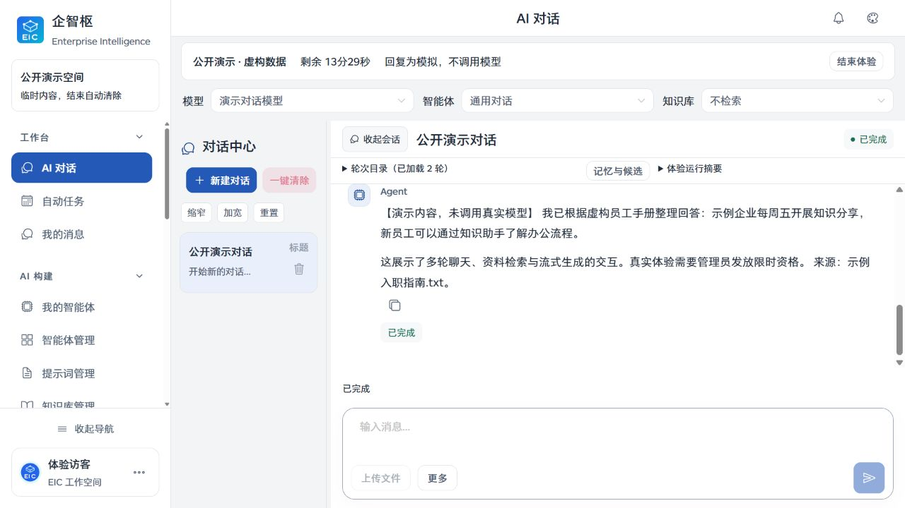
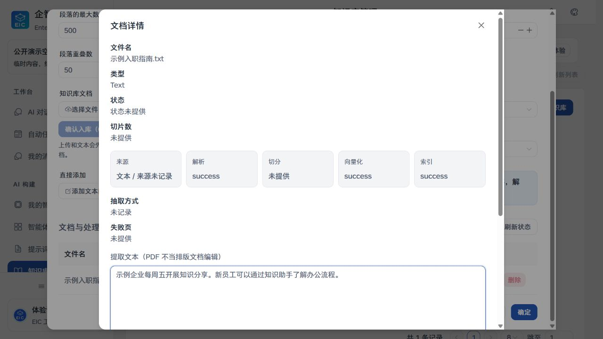
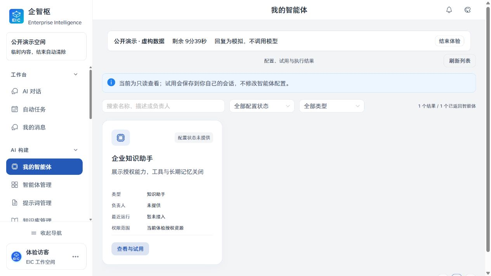
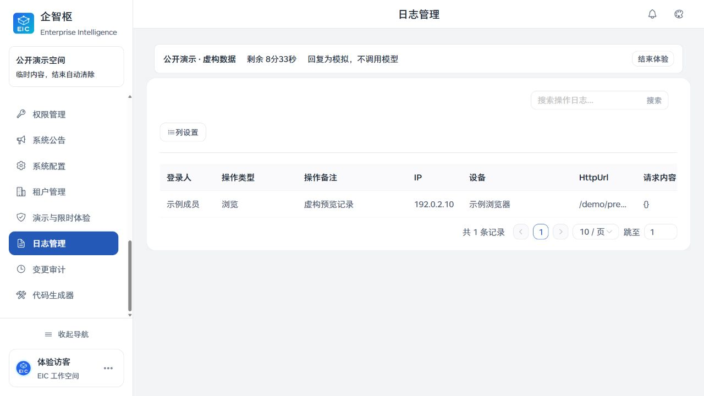

<div align="center">


# EIC 企智枢 | Enterprise Intelligence Center

**面向企业知识工作的 AI 工作空间**  
**A self-hostable AI workspace for enterprise knowledge work**

把知识检索、AI 对话、Agent 执行、组织权限与运行记录放进同一工作空间。  
Bring knowledge retrieval, AI conversations, agent execution, access control, and run records into one workspace.


[快速体验](#quick-start) · [界面预览](#product-screens) · [能力概览](#capabilities) · [系统架构](#architecture) · [路线图](#roadmap) · [文档](#documentation)

</div>

## 项目简介 | What Is EIC

EIC 面向需要管理内部知识、构建 AI 助手并控制组织访问边界的团队。平台把知识库与检索、模型接入、Agent 工作流、任务执行和管理后台整合在一起，支持本地模拟与自托管部署。

EIC brings knowledge bases and retrieval, model integrations, agent workflows, task execution, and administration into one platform for teams that need control over enterprise knowledge and access boundaries. It supports both a local simulation and self-hosted deployments.

**工作流 | Workflow:** 文档与知识库 → 检索与引用 → Agent 对话或任务 → 运行记录与审计  
**Documents and knowledge → retrieval and citations → agent conversations or tasks → run records and audit**

<a id="capabilities"></a>

## 能力概览 | Capabilities

| 能力 | 说明 | Capability | Description |
| --- | --- | --- | --- |
| 知识与检索 | 文档解析、分块、向量化及权限过滤检索；回答可关联来源。 | Knowledge and retrieval | Parse, chunk, embed, and permission-filter documents; answers can include sources. |
| AI 助手 | 多轮与流式对话，支持模型、知识库、技能和工具配置。 | AI assistants | Multi-turn streaming conversations with configurable models, knowledge, skills, and tools. |
| Agent 与任务 | 使用 LangChain 与 LangGraph 组织 Agent 流程，并提供后台任务能力。 | Agents and tasks | Compose agent workflows with LangChain and LangGraph, with background task support. |
| 企业管理 | 管理租户、组织、用户、角色和权限。 | Administration | Manage tenants, organizations, users, roles, and permissions. |
| 运行记录 | 提供本地运行记录与审计；可选 Langfuse 导出默认关闭。 | Run records | Local run records and audit logs; optional Langfuse export is disabled by default. |

<a id="product-screens"></a>

## 界面预览 | Product Screens

下列画面来自 EIC 自身的公开演示模式，内容为虚构样例。演示回复是固定文本，不调用真实模型；截图不是生产运行或真实客户数据。

These screens are from EIC's public demo mode and contain fictional examples. Demo replies are fixed text and do not call a real model; the screenshots do not show production or customer data.

<table>
  <tr>
    <th>AI 对话 | AI conversation</th>
    <th>知识库 | Knowledge base</th>
  </tr>
  <tr>
    <td></td>
    <td></td>
  </tr>
  <tr>
    <td>对话区域展示模拟回复、示例来源和完成状态。<br>Shows a simulated reply, example source, and completion state.</td>
    <td>文档详情展示虚构入职指南及解析、向量化和索引阶段。<br>Shows a fictional onboarding guide and its parsing, embedding, and indexing stages.</td>
  </tr>
  <tr>
    <th>智能体 | Agent</th>
    <th>操作日志 | Audit log</th>
  </tr>
  <tr>
    <td></td>
    <td></td>
  </tr>
  <tr>
    <td>只读展示智能体类型与体验授权范围；演示夹具不包含完整配置。<br>Read-only agent type and demo access scope; the fixture does not include a full configuration.</td>
    <td>日志使用示例成员、示例浏览器和文档保留地址段 IP。<br>Logs use a sample member, sample browser, and an IP from a documentation-only address range.</td>
  </tr>
</table>

<a id="architecture"></a>

## 系统架构 | Architecture


| 层级 | 技术 |
| --- | --- |
| 前端 | Vue 3、Vite、Naive UI |
| API 与数据层 | FastAPI、SQLAlchemy Async、Alembic |
| Agent 流程 | LangChain、LangGraph |
| 本地模拟 | SQLite；无需 Docker、Redis、向量数据库或模型 API Key |
| 自托管部署 | MySQL 8.4+ 或 PostgreSQL 16 + PGVector，可组合 Redis 7+ 与 ARQ |

完整组件边界与数据流见[架构说明](docs/ARCHITECTURE.md)。本地模拟不代表完整生产队列、向量基础设施或真实模型调用。

<a id="quick-start"></a>

## 快速体验 | Quick Start

本地模拟需要 Python 3.11+、Node.js 20+；Windows 使用 PowerShell 7，Linux 使用 Bash。它不需要 Docker、MySQL、PostgreSQL、Redis 或模型 API Key。

The local simulation requires Python 3.11+ and Node.js 20+. Use PowerShell 7 on Windows or Bash on Linux. Docker, MySQL, PostgreSQL, Redis, and a model API key are not required.

**Windows | PowerShell**（从仓库根目录执行 | run from the repository root）:

```powershell
python -m venv backend\.venv
backend\.venv\Scripts\python.exe -m pip install -e .\backend
Push-Location frontend
npm ci
npm run build
Pop-Location
pwsh -NoProfile -ExecutionPolicy Bypass -File .\scripts\start-sim.ps1 -OpenBrowser
```

**Linux | Bash**（从仓库根目录执行 | run from the repository root）:

```bash
python3 -m venv backend/.venv
backend/.venv/bin/python -m pip install -e ./backend
cd frontend
npm ci
npm run build
cd ..
bash scripts/start-sim.sh
```

打开 `http://127.0.0.1:8080/login`。模拟环境使用租户 `1000`、账号 `admin`；临时密码由脚本在本机生成并写入 `data/admin-password.txt`。`data/` 同时保存模拟数据库和密钥，**不要提交或分享该目录**。完整部署与开发步骤见[安装与首次运行](docs/GETTING_STARTED.md)。

Open `http://127.0.0.1:8080/login`. The simulation uses tenant `1000` and account `admin`; a temporary password is generated locally in `data/admin-password.txt`. The `data/` directory also stores the simulation database and secrets. **Do not commit or share it.** See [Getting Started](docs/GETTING_STARTED.md) for full deployment and development instructions.

## 演示边界 | Demo Boundaries

- 公开演示需要管理员显式启用；所有可浏览页面使用合成数据，回复不会调用真实模型。
- 限时真实体验只能访问管理员明确授权的模型、Agent 和知识库，并受时长与预算限制。
- 公开演示截图不含真实用户资料、业务文档、生产凭据或真实观测记录。
- 本地模拟适合探索 UI 和基础流程，不能证明外部模型、生产数据库、后台队列或部署容量已经验证。

- Public demo access must be explicitly enabled by an administrator. Browsable pages use synthetic data and replies do not call a real model.
- Time-limited live access is restricted to administrator-approved models, agents, and knowledge bases, with time and budget limits.
- Public demo screenshots contain no real user profiles, business documents, production credentials, or production traces.
- The local simulation is for exploring the UI and basic flows; it does not validate external models, production databases, background queues, or deployment capacity.

<a id="roadmap"></a>

## 路线图 | Roadmap

路线按三个方向并行推进，不承诺具体日期；优先级会结合社区反馈和验证结果调整。

The roadmap is organized into three parallel tracks with no release dates. Priorities may change with community feedback and validation results.

| 方向 | 下一步 | Track | Next |
| --- | --- | --- | --- |
| 开源上手 | 持续打磨本地模拟、首次运行说明和贡献者验证路径。 | Open-source onboarding | Refine the local simulation, first-run guide, and contributor validation path. |
| AI 能力 | 围绕固定场景持续完善检索与 Agent 流程评测。 | AI capabilities | Improve retrieval and agent workflow evaluation around fixed scenarios. |
| 企业部署与运维 | 补齐部署验收、恢复流程和可选集成的验证说明。 | Enterprise deployment and operations | Improve deployment checks, recovery guidance, and validation notes for optional integrations. |

<a id="documentation"></a>

## 文档 | Documentation

| 主题 | 文档 |
| --- | --- |
| 上手 | [安装与首次运行](docs/GETTING_STARTED.md) · [公开演示与限时体验](docs/public-experience.md) |
| 架构与部署 | [系统架构](docs/ARCHITECTURE.md) · [部署与运维](docs/OPERATIONS.md) · [迁移](docs/MIGRATION.md) |
| AI 与运行时 | [记忆与上下文](docs/MEMORY-CONTEXT.md) · [检索索引与观测投递](docs/MEMORY-INDEXING.md) · [可靠性与降级](docs/RELIABILITY-FALLBACK.md) · [Harness 与评测](docs/HARNESS-EVALUATION.md) |
| 接入与依赖 | [MinerU 接入](docs/mineru-integration.md) · [本地 Langfuse 接入](docs/LANGFUSE-LOCAL.md) · [依赖清单](docs/DEPENDENCIES.md) |
| 参与项目 | [贡献指南](CONTRIBUTING.md) · [安全问题报告](SECURITY.md) · [第三方声明](NOTICE.md) |

## 集成与许可 | Integrations and License

MinerU 是可选的私有 PDF 解析适配器，默认关闭；本源码包不安装或运行 MinerU 引擎。Langfuse 可连接自托管实例，EIC 导出器默认关闭。启用这些能力前请阅读对应文档中的网络、数据保留、资源和许可边界。

MinerU is an optional private PDF parsing adapter and is disabled by default; this source package does not install or run the MinerU engine. Langfuse can connect to a self-hosted instance, and the EIC exporter is disabled by default. Review the related documentation for network, retention, resource, and licensing boundaries before enabling either integration.

EIC source is distributed under the [Mulan Permissive Software License, Version 2](LICENSE). Some dependencies have separate terms. In particular, PyMuPDF/MuPDF is offered under AGPL or a commercial license; review the [third-party notices](NOTICE.md) and upstream terms for your intended distribution and use. The project license does not replace dependency-specific obligations.

EIC 源码使用[木兰宽松许可证第 2 版](LICENSE)。部分依赖有独立许可，尤其 PyMuPDF/MuPDF 提供 AGPL 或商业许可；请根据分发和使用方式核对[第三方声明](NOTICE.md)及上游条款。项目许可证不会取代依赖自身的许可义务。

欢迎通过仓库的 Issue 和 Pull Request 参与；安全问题请先阅读[安全报告说明](SECURITY.md)。

Contributions are welcome through repository issues and pull requests. For security reports, read [SECURITY.md](SECURITY.md) first.
