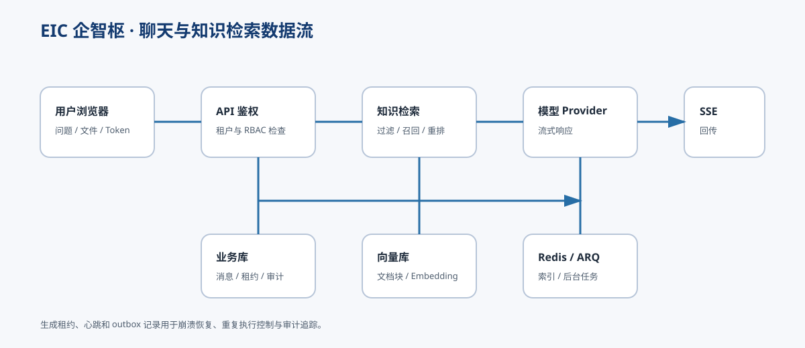

# 架构说明




## 分层

1. **浏览器层**：Vue 3 页面、路由、Axios、SSE 流式读取和安全 HTML 净化。
2. **API 层**：FastAPI 路由、认证、租户隔离、RBAC、上传审计和健康检查。
3. **领域层**：知识库、文档分块、召回、AI 应用、聊天、任务和消息读取状态。
4. **持久化层**：SQLAlchemy async、Alembic、MySQL；本地模拟使用 SQLite。
5. **异步与向量层**：Redis/ARQ 执行后台任务，PostgreSQL/PGVector 保存向量；Qdrant 适配器只用于过渡读取和召回对比。

## 请求路径

典型聊天请求经过：

```text
Browser -> Vue Router -> Axios/SSE -> FastAPI
        -> tenant/RBAC checks -> chat history
        -> retrieval -> provider stream
        -> generation lease + outbox/audit
        -> SSE events -> Browser
```

生成过程使用持久租约和心跳，避免进程崩溃后记录永久停留在 `generating`。ID 分配器使用数据库协调，避免多进程和时钟回拨造成重复 ID。

## 数据边界

- 业务库：用户、租户、组织、消息、AI 配置、知识库元数据和审计记录。
- 文件库：上传文件与索引源文件，生产环境应使用独立持久卷。
- 向量库：文档块向量和召回索引。
- Redis：队列、任务调度和短期执行状态。

## 配置原则

- 启动前显式执行迁移，不在应用启动时隐式建表。
- 生产环境关闭 `EIC_BOOTSTRAP_ENABLED` 和 `EIC_SEED_DEMO_DATA`。
- 密钥只通过环境变量或密钥管理系统注入。
- 相对路径以 `backend/` 为基准解析，避免从不同工作目录启动时写错数据目录。
